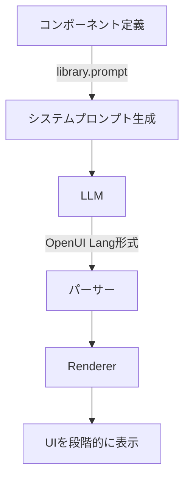

## はじめに
Generative UIって何なのか理解しようと思うと、いろんな新しい単語があったりして難しそうに感じると思います。自分も難しいと感じた一人なので、Generative UIを実現するためのフレームワークの1つであるOpenUIを試しつつ、Generative UIのイメージを掴んでもらえるような記事にしていきたいと思います。OpenUI自体はクイックスタートなどで簡単に試すことができ、面白いと感じる部分があったので、そのあたりも共有していこうと思います。

## まず、Generative UIがないAIからの回答表示
Generative UIがない場合、マークダウン形式で出力したものにスタイルをつけることは可能です。
下の画像はVSCodeのmdプレビューですが、こんな感じで、mdテキストを視覚的に見やすくすることはできます。

*左：mdコード / 右：mdのプレビュー*

アプリでマークダウンをプレビューのような見た目で表示するためのライブラリも色々存在し、マークダウンを機械的にどう変換するかなどのロジックを組み込めば、AIからのマークダウン回答を比較的リッチに見せることはできます。
ただ、その自由さには限界があり、「より自由でわかりやすい見た目で表示してほしい」や「出力されたUIをユーザーが画面操作できるようにしたい」みたいな場合には、Generative UIで出力できれば、これまで難しかった表現もできるようになります。

## Generative UIとは
Generative UIとはすごく簡単に言うと、AIがどのようなUIにするかまで考えて出力してくれるって感じです。上で紹介したマークダウンで見た目をリッチにするというのは、あくまでAIは回答に必要な情報をマークダウンで返して、リッチにしているのは機械的なルールで変換する感じでした。
とはいえ、マークダウンをリッチに見せる場合もGenerative UIと一部似たようなことをやっている部分もあって、正直わかりづらい人もいると思うので、下図のような見た目が実現できるのがGenerative UIと思ってもらうのがわかりやすいです！


これはClaude Desktopの回答ですが、地図が表示されて、その地図を画面操作できているのがわかると思います。マークダウンだけで、このような操作可能な地図を表現するのは難しいことが分かると思います。

## Generative UIの生成方法の種類

[OpenUIのレポート](https://www.openui.com/blog/state-of-generative-ui-report)では、Generative UIの生成方法を大きく以下の3種類に整理しています。

| 種類 | 自由度 |
| --- | --- |
| Static（静的型） | 少ない |
| Declarative（宣言型） | 中間 |
| Open-Ended（オープンエンド型） | 大きい |

手法によって生成されるUIの自由度が異なります。自由なのが良いかというと、そうでもなくて、AIが自由にUIを作れた場合、全体のデザインに沿わないUIが出力されたり、使いづらいUIになることもあると思います。なので、適切な制御を入れることも重要ということです。
:::message
3つの種類について、これからイメージ画像を使って説明しますが、あくまでイメージを掴むものと捉えてください。
:::

### Static（静的型）
静的型は事前定義したコンポーネントをAIエージェントが選択する感じです。
イメージとしては下図のように、馬と鳥という選択肢の中から、ユーザーの質問に合う方をAIが選んでくれる感じです。


:::message
適当に「イラストや」から画像を拾っただけで、馬と鳥に深い理由は全くありません。
:::

### Declarative（宣言型）
宣言型は、宣言的にUIのパーツや制約などを定義しておき、それをAIエージェントが理解して組み立ててくれるようなイメージです。静的型より自由にUIを作ることができ、かつ用意したパーツの範囲に出力を制限しやすい、いわばバランス型です。
イメージとしては、下図のように馬と鳥の身体がパーツに分解されており、それを組み合わせれば、ペガサスっぽい画像を作ることができ、用意した「イラストや」のデザインからも大きく外れない出力になっています。


### Open-Ended（オープンエンド型）
オープンエンド型は、フロントエンドのパーツも用意せず、AIに自由にUIを作らせるって感じです。基本的にはHTML・CSS・JavaScriptをAIに出力させ、それをiframe内で表示します。
イメージとしては、自由に作れるから下図のようにかっこいいペガサスを出すこともできる、けど周囲のデザインが「イラストや」の場合は、浮いちゃうなって感じです。


## OpenUIの説明
### OpenUIとは
https://www.openui.com
OpenUI Langという、LLMがUIを生成するために設計された言語を使って、Generative UIを実現できるフレームワークです。
公式ベンチマークでは、JSON形式と比べて最大67.1%少ないトークンで同じUIを表現できたとされています。出力トークンが少なくなることで、生成時間やコストを抑えられる可能性があります。
OpenUIの公式サイトには、どんなUIを実現できるのか試せるチャットも用意されていて、実際に触ってみるとすごくイメージが湧くと思います。

### OpenUIの処理フロー
主に開発者が用意するものは以下の2つになります。
- AIが出力するためのパーツをコンポーネントとして定義
- そのコンポーネントをOpenUI Lang形式で出力できるようなプロンプトを用意

プロンプトの基本部分はコンポーネント定義から自動生成できるため、コンポーネントを定義すれば、LLMに使い方を伝えるところまでOpenUIが補助してくれます。
プロンプトを基にLLMがOpenUI Lang形式でテキストを出力し、パーサーがテキストを解釈し、RendererでReactコンポーネントに対応付けて画面に描画します。
途中の処理をすべて理解していなくても、コンポーネントを揃えればそれらしいUIを動かすことはできますし、それぞれのパーツをコードでカスタマイズすることも可能です。



### Agent Skill、MCPサーバー
https://www.openui.com/docs/mcp#install-via-the-skills-cli-recommended
開発を補助するAgent Skillが用意されているほか、OpenUIのドキュメントはContext7のMCPサーバー経由でも参照できます（詳しくは上記リンクを参照してください）。
Agent Skillは以下のコマンドで導入できます。自分はこのSkillだけを入れて開発してみましたが、便利でした。
```bash:ターミナル
npx skills add thesysdev/openui --skill openui
```

### クイックスタート
https://www.openui.com/docs/openui-lang/quickstart
公式ドキュメントにクイックスタートもあり、手順通りnpxコマンドでNext.jsアプリを作成できます。OpenAIのAPIキーを追加して、npm run devで起動すれば簡単にローカルでOpenUIの挙動を確認できるので、非常に簡単でよかったです。
クイックスタートで生成されたアプリを起動すると、最初からチャット画面が用意されています。
`@openuidev/react-ui` には `FullScreen`・`BottomTray`・`Copilot` といったレイアウトのバリエーションも含まれており、用途に合わせて使い分けることができます。

:::message
OpenUIは更新が速く、現在の公式クイックスタートでは `AgentInterface` と `openuiChatLibrary` が使われています。この記事のリポジトリは、作成時の構成である `FullScreen` と `openuiLibrary` を使って説明しますが、コンポーネント定義からプロンプトを作り、LLMの出力を描画する基本的な流れは同じです。
:::

すぐに動くものが確認できる状態から始められるので、カスタムコンポーネントを作ったりいくつか拡張しつつ試したリポジトリが以下になります（クイックスタート同様npm run devで簡単に動作できるはずです）。
https://github.com/shimpei1494/genui-chat-app

:::message
これから、このリポジトリで試したことを紹介しつつOpenUIへの理解を深めていきます。
コードの詳細は上記リポジトリを参照してください。
:::

## クイックスタートのデフォルト挙動確認
まずはコードを変更していないデフォルトの状態で、どんなUIが出てくるのかを確認してみます。
アプリを起動後、http://localhost:3000 にアクセスして、質問を投げると下の動画のようにストリーミングでUIが作られます。質問を変えれば色々なUIが出てくることが確認できると思います。


この記事で使用したクイックスタートのアプリには、`@openuidev/react-ui/genui-lib` から提供される **`openuiLibrary`** が最初から組み込まれています。
ただし、どのコンポーネントが含まれているかはコードを読むだけでは少しわかりづらく、`page.tsx` を見ても `componentLibrary={openuiLibrary}` と渡されているだけです。

実際に含まれているコンポーネントは以下のコマンドで確認できます。

```bash:ターミナル
node --input-type=module <<'EOF'
import { openuiLibrary } from '@openuidev/react-ui/genui-lib';
console.log(Object.keys(openuiLibrary.components).join('\n'));
EOF
```

この記事で確認した `@openuidev/react-ui 0.11.9` では、全部で **54コンポーネント**が用意されていました。カテゴリ別に整理すると以下のようになります。

| カテゴリ | 主なコンポーネント |
| --- | --- |
| コンテンツ | `TextContent` `MarkDownRenderer` `Callout` `CodeBlock` `Table` |
| 画像 | `Image` `ImageBlock` `ImageGallery` |
| チャート | `BarChart` `LineChart` `AreaChart` `PieChart` `RadarChart` など |
| フォーム | `Form` `Input` `Select` `DatePicker` `Slider` `CheckBoxGroup` など |
| レイアウト | `Stack` `Card` `Tabs` `Accordion` `Steps` `Carousel` `Modal` |
| タグ | `TagBlock` `Tag` |

チャートやフォームまで揃っているため、コンポーネントを追加実装しなくても、かなり多様なUIを生成してもらえます。

### LLMへ渡されるシステムプロンプトを確認する

LLMには `openuiLibrary.prompt()` で生成したシステムプロンプトが渡されており、各コンポーネントの引数・型・説明が含まれています。内容は以下のコマンドで確認できます。

```bash:ターミナル
npx @openuidev/cli@latest generate ./src/library.ts \
  --out system-prompt.txt
```

生成された `system-prompt.txt` を開くと、LLMがどのような指示のもとでUIを出力しているかを確認できます。現在の公式クイックスタートでは開発・ビルド時に自動生成する設定も含まれますが、この記事のリポジトリでは実行時に `openuiLibrary.prompt()` から生成しているため、上のコマンドはプロンプトを確認したい場合に実行します。

:::message
とても簡単にGenerative UIを試すことができて面白いですが、組み込みのUIコンポーネントやプロンプトを使っていて理解しづらい部分もあるため、カスタムコンポーネントを定義して、よりOpenUIのイメージを掴んでいきましょう。
コードが増えてわかりづらいかもしれないので、ざっくり雰囲気で読み進めてもらえれば大丈夫です！
:::


## カスタムコンポーネントを追加してみる

デフォルトのコンポーネントは残したまま、比較用に `/custom` という別ページを作り、以下の4つだけを使う小さなコンポーネントライブラリを用意しました。

| コンポーネント | 用途 |
| --- | --- |
| `TextBlock` | 回答の導入や補足となる短い文章 |
| `InfoCard` | おすすめやアイデアを、タイトル・説明・タグ付きで表示 |
| `MetricCard` | 完了率などの重要な数値を強調して表示 |
| `ResponseLayout` | 上記のコンポーネントを縦に並べるルートレイアウト |

### コンポーネントを定義する

コンポーネントは `defineComponent` を使って定義します。たとえば `InfoCard` の定義は、要点だけ抜き出すと以下のようになっています。

```tsx:src/openui/custom-library.tsx
const InfoCard = defineComponent({
  name: "InfoCard",
  description:
    "Highlights one recommendation or idea with a title, explanation, and optional tags.",
  props: z.object({
    title: z.string(),
    description: z.string(),
    eyebrow: z.string().optional(),
    tags: z.array(z.string()).optional(),
  }),
  component: ({ props }) => (
    <article className="rounded-2xl border bg-white p-5 shadow-sm">
      {props.eyebrow && <p>{props.eyebrow}</p>}
      <h3>{props.title}</h3>
      <p>{props.description}</p>
      {props.tags?.map((tag) => <span key={tag}>{tag}</span>)}
    </article>
  ),
});
```

1つの定義の中に、主に次の3つを書きます。

- `description`：どのような場面で使うコンポーネントなのか
- `props`：LLMが指定できる値とその型
- `component`：実際にブラウザへ表示するReactコンポーネント

`props` はZodで定義します。コンポーネントによって異なりますが、上の例では `title` と `description` は必須、`eyebrow` と `tags` は任意です。つまり、LLMに見た目をすべて自由に書かせるのではなく、**こちらで用意した見た目に対して、LLMが内容と組み合わせ方を決める**形になります。

さらに、子コンポーネントを受け取る `ResponseLayout` も定義しました。

```tsx:src/openui/custom-library.tsx
const ResponseLayout = defineComponent({
  name: "ResponseLayout",
  props: z.object({
    children: z.array(
      z.union([TextBlock.ref, InfoCard.ref, MetricCard.ref]),
    ),
  }),
  component: ({ props, renderNode }) => (
    <section className="flex flex-col gap-3">
      {renderNode(props.children)}
    </section>
  ),
});
```

`.ref` を使うことで、`ResponseLayout` の子には今回用意した3種類のコンポーネントを配置できる、と定義しています。最後にそれぞれをライブラリへ登録します。

```tsx:src/openui/custom-library.tsx
export const customLibrary = createLibrary({
  root: "ResponseLayout",
  components: [ResponseLayout, TextBlock, InfoCard, MetricCard],
  componentGroups: [
    {
      name: "Layout",
      components: ["ResponseLayout"],
      notes: ["Always use ResponseLayout as the root component."],
    },
    {
      name: "Content",
      components: ["TextBlock", "InfoCard", "MetricCard"],
      notes: ["Use MetricCard only when a meaningful numeric value is present."],
    },
  ],
});
```

`root` も指定しているため、生成される回答は必ず `ResponseLayout` から始まります。`componentGroups` ではコンポーネントを役割ごとにまとめ、使い方の注意も加えています。コンポーネントの種類をあえて少なくすることで、OpenUI LangとReactコンポーネントの対応も追いやすくなりました。

### プロンプトはどのように設定したか

今回はコンポーネントを定義するだけでなく、回答全体の方針、追加ルール、出力例も設定しました。

```tsx:プロンプト設定の抜粋
export const customPromptOptions = {
  preamble:
    "You are a helpful assistant that answers with a small, clear interface using the available components.",
  additionalRules: [
    "Reply in the same language as the user.",
    "Prefer one short TextBlock followed by only the cards that improve the answer.",
    "Do not use MetricCard unless the answer contains a meaningful numeric value.",
  ],
  examples: [
    `root = ResponseLayout([intro, card])
intro = TextBlock("目的に合わせて、次の案を検討できます。")
card = InfoCard("小さく始める", "最小構成で試します。", "おすすめ", ["低リスク"])`,
  ],
} satisfies PromptOptions;

const systemPrompt = customLibrary.prompt(customPromptOptions);
```

`customLibrary.prompt()` は、登録したコンポーネントの名前・説明・propsなどを元に、OpenUI Langを出力させるためのシステムプロンプトを生成します。そのため、各コンポーネントの使い方をすべて手書きする必要はありません。

一方で、「ユーザーと同じ言語で回答する」「意味のある数値がない場合は `MetricCard` を使わない」といったアプリ固有の判断は `additionalRules` に追加しました。`examples` には期待するOpenUI Langの例を入れています。

生成した `systemPrompt` は、通常の会話履歴と一緒に `/api/chat` へ渡しています。つまり `customPromptOptions` はCLIが生成した回答を保存する場所ではなく、**LLMにどのようなOpenUI Langを出力してほしいかを補足する設定**です。

### カスタムコンポーネントで回答生成した結果
用意したカスタムコンポーネントとプロンプトで、下の動画のように回答を生成できることが確認できました（ローカルで起動して、http://localhost:3000/custom で確認可能）。


### コンポーネントギャラリーを作る
とりあえずいい感じにUIを出すことはできましたが、実際にどんなUIのバリエーションがあるのか分かりづらいため、AIを使わずにUIを確認できるギャラリーページも作成しました（http://localhost:3000/custom/gallery ）。


使用するコンポーネントやpropsの値が異なる場合、複数のコンポーネントを組み合わせた場合などのUIを確認できます。
「OpenUI Langを表示」の折りたたみを開くことで、OpenUI Langとその描画結果を並べて確認できるようになっています。

もう少しだけ補足で説明すると、例えば以下のOpenUI Langを用意します。

```text:src/openui/fixtures.ts
root = ResponseLayout([intro, recommendation, progress])
intro = TextBlock("現在の進捗と、次に取り組む内容をまとめました。")
recommendation = InfoCard("残りのタスクを優先する", "影響の大きいタスクから順に確認します。", "次のアクション", ["優先順位", "期限重視"])
progress = MetricCard("現在の進捗", "80%", "全10件中8件が完了しています。", "emerald")
```

これをチャットAPIへ送るのではなく、`Renderer` に直接渡します。

```tsx:src/app/custom/gallery/page.tsx
<Renderer
  library={customLibrary}
  response={fixture.source}
  isStreaming={false}
/>
```

すると、`ResponseLayout` の中に文章、提案カード、数値カードが順番に描画されます。OpenUI Langの `InfoCard(...)` がReactの `InfoCard` に対応し、引数がZodで定義した順番でpropsへ渡されることも確認できます。


このようにAIがOpenUI Langを出力した後は、パーサーとRendererが事前に定義した規則に従ってUIを構築します。

## HTML・CSS・JavaScriptを自由に生成する方法も試す（オープンエンド型）
ここまでは、あらかじめ用意したReactコンポーネントをLLMに組み合わせてもらう宣言型のGenerative UIを試しました。次はもう少し自由度を上げて、LLMにHTML・CSS・JavaScriptを生成してもらうオープンエンド型も試してみます。
:::message
OpenUIは宣言型を中心に扱うフレームワークですが、iframeを描画するコンポーネントを自作すれば、OpenUIを受け渡しに使ってオープンエンド型を組み込むこともできます。
:::

### 実装と仕組み

今回作ったのは、`GeneratedView` というコンポーネントです。受け取るpropsは、生成されたHTML文字列、表示する高さ、タイトルの3つだけにしました。

```tsx:src/openui/generated-view-library.tsx
const generatedViewProps = z.object({
  html: z.string(),
  height: z.number().min(240).max(900).optional(),
  title: z.string().optional(),
});

export const GeneratedView = defineComponent({
  name: "GeneratedView",
  description:
    "Renders a one-off, self-contained HTML/CSS/JS fragment inside an isolated sandbox.",
  props: generatedViewProps,
  component: GeneratedViewRenderer,
});
```

`GeneratedViewRenderer` では、受け取ったHTML文字列をiframeの `srcDoc` に渡して表示します。以下は、ストリーミング中の分岐などを省略した説明用のコードです。

```tsx:src/openui/generated-view-library.tsx
function GeneratedViewRenderer({
  props,
}: {
  props: z.infer<typeof generatedViewProps>;
}) {
  const sandboxDocument = createSandboxDocument(props.html);

  return (
    <iframe
      height={props.height ?? 560}
      sandbox="allow-scripts"
      srcDoc={sandboxDocument}
      title={props.title ?? "AI generated interface"}
    />
  );
}
```

ここで少し大事なのは、**OpenUIが任意のHTMLを直接画面に描画しているわけではない**という点です。OpenUIはLLMが出力した `GeneratedView(...)` を解釈してReactコンポーネントにつなぎ、実際にHTML・CSS・JavaScriptを表示しているのは、その中に実装したiframeです。

処理の流れは次のようになります。

```text:処理フロー
LLM
  → HTML・CSS・JavaScriptを含むGeneratedViewを出力
  → OpenUIがGeneratedViewを描画
  → GeneratedView内のiframeへsrcDocとして渡す
```

今回は仕組みを単純に確認したかったため、ライブラリに登録するコンポーネントも `GeneratedView` だけにしました。

```tsx:src/openui/generated-view-library.tsx
export const generatedViewLibrary = createLibrary({
  root: "GeneratedView",
  components: [GeneratedView],
});
```

プロンプトでは、回答全体を1つの `GeneratedView` として出力すること、HTML内にインラインのCSSと必要に応じてJavaScriptを含めること、外部URLや通信機能を使わないことなどを指定しています。要点だけ抜き出すと以下のようになります。

```tsx:src/openui/generated-view-library.tsx
const generatedViewPromptOptions = {
  additionalRules: [
    "The first and only statement must be root = GeneratedView(html, height, title).",
    "The html argument must be one self-contained HTML body fragment with inline <style> and optional inline <script> tags.",
    "Do not use external URLs, fetch, forms, storage, or navigation.",
    "Use JavaScript only when interaction materially improves the answer.",
  ],
};
```

LLMからは、イメージとして次のようなOpenUI Langが返ってきます。実際の `html` にはCSSやJavaScriptも含まれるのでかなり長い1行になりますが、構造自体はシンプルです。

```text:OpenUI Langの出力例
root = GeneratedView("<style>...</style><main>...</main><script>...</script>", 460, "惑星の公転")
```

この方法なら、事前にカードやグラフのコンポーネントを定義していなくても、質問に合わせたレイアウトをその場で作れます。実際に試したところ、HTMLとCSSによるカード表示だけでなく、JavaScriptで動くカウンターや、Canvasで惑星を動かして再生・一時停止できるUIも表示できました。

:::message
http://localhost:3000/generated で試すことはできますが、回答の生成完了までに時間がかかるうえ、次のギャラリー画面で挙動はほぼ説明できるので、質問から回答までの動画は割愛します。
:::

### ギャラリー画面

こちらにも http://localhost:3000/generated/gallery という確認用ページを作り、静的なHTML、インラインCSS、JavaScriptによる操作、Canvasアニメーションを固定データで確認できるようにしました。アプリ起動すれば下の動画のように、HTML・CSS・JavaScriptから作られたUIがiframe内で動作する様子を確認できます。


### iframeで表示するときに考えたこと

LLMが生成したJavaScriptをそのまま実行するため、通常のReactコンポーネントを表示する場合よりも安全性に注意が必要です。また、iframeとストリーミングを組み合わせるうえで、実装中につまずいた点もありました。この記事の本筋からは少し外れるため、今回行った対策を以下に折りたたんでおきます。

:::details iframeの実装と安全性について
今回のiframeには `sandbox="allow-scripts"` を設定しました。JavaScriptの実行だけを許可し、`allow-same-origin` は付けていません。これにより、生成された画面を親アプリとは異なる不透明なオリジンとして扱い、親画面のDOM、Cookie、ストレージなどへ直接アクセスできないようにしています。

さらにiframe内のHTMLへCSP（Content Security Policy）を追加し、外部への通信、フォーム送信、別のiframeや外部リソースの読み込みなどを制限しました。CSSとJavaScriptはインラインのみ許可しています。

```text:src/openui/generated-view-library.tsx（CSP）
default-src 'none';
connect-src 'none';
form-action 'none';
frame-src 'none';
object-src 'none';
script-src 'unsafe-inline';
style-src 'unsafe-inline';
img-src data: blob:;
```

もう1つつまずいたのがストリーミングです。生成途中の不完全な `srcDoc` をiframeへ渡し続けると、iframeが何度も再読み込みされ、最終的なHTMLがpropsに入っているのに画面が真っ白になることがありました。

そこで今回は、OpenUI Langのストリーミング中は「UIを生成しています…」という表示にしてiframeを作らず、生成完了後に完成したHTMLで一度だけiframeをマウントしています。そのため、定義済みコンポーネントのようにUIが少しずつ組み上がる表示にはしていません。

ただし、これらを設定すれば完全に安全になるわけではありません。重いJavaScriptによるCPU・メモリ消費、外部ページへの遷移、ユーザーをだますような画面などのリスクは残ります。今回はローカルで仕組みを確認するための実装であり、本番環境で利用する場合は、生成内容の検査、実行時間やサイズの制限、Permission Policy、別オリジンでの配信など、用途に応じた追加対策が必要です。
:::

### 画面の一部分だけをオープンエンド型にすることもできる

今回は理解しやすさを優先して、回答全体を `GeneratedView` にする専用ページを作りました。そのため、実装したもの自体は宣言型とOpen-Ended型を組み合わせてはいません。

ただ、OpenUIのコンポーネントとして見ると、`GeneratedView` も先ほど作った `InfoCard` や `MetricCard` と同じ1つの部品です。たとえば同じライブラリへ `GeneratedView` を登録し、`ResponseLayout` の子として `GeneratedView.ref` も許可すれば、通常の文章やカードは定義済みコンポーネントで表示し、質問に応じた図や操作UIだけをiframeで生成する、といった構成にもできます。

```tsx:宣言型とオープンエンド型の組み合わせ例
children: z.array(
  z.union([
    TextBlock.ref,
    InfoCard.ref,
    MetricCard.ref,
    GeneratedView.ref,
  ]),
)
```

すべてを自由生成にするのではなく、基本部分はデザインを管理しやすい宣言型にして、既存コンポーネントでは表現しづらい部分だけOpen-Ended型にする、という使い分けも考えられます。自由度と制御のバランスを取りやすく、実際のアプリではこのような部分利用の方が扱いやすい場面も多そうです。

### オープンエンド型のデメリット

オープンエンド型のデメリットと感じたところも簡単にですが、書いておきます。

- プロンプトで指示は与えられるが、AIがどんなUIを出してくるかは制御が効きづらい
- 宣言型と比べてHTML・CSS・JavaScriptを出力するため、出力トークンが増え、コストや生成完了までの時間の増加につながる（実際、生成完了までかなり遅く感じました）
- iframe内で実行されるコードの安全性については注意が必要

## 実は、すべて同じチャットAPIを使っている

ここまで、クイックスタートのデフォルト画面、独自コンポーネントを使う画面、HTML・CSS・JavaScriptを自由に生成する画面の3種類を作りました。

見た目や出力内容はかなり異なりますが、実はすべて同じ `/api/chat` を使っています。

```tsx:src/app/api/chat/route.ts
const { messages, systemPrompt } = await req.json();

const response = await client.chat.completions.create({
  model: "gpt-5.2",
  messages: [
    { role: "system", content: systemPrompt },
    ...messages,
  ],
  stream: true,
});
```

このAPIが行っているのは、画面側から受け取ったシステムプロンプトと会話履歴をLLMへ渡し、返ってきたテキストをストリーミングすることです。API自体は、どのReactコンポーネントを使うのかや、iframeで表示するのかを知りません。

画面ごとに変えているのは、主に以下の2つです。

- LLMへ渡すシステムプロンプト
- LLMの出力を解釈・描画するコンポーネントライブラリ

デフォルト画面ではOpenUI組み込みのコンポーネント、`/custom` では独自に作ったカード、`/generated` では `GeneratedView` を使っています。

LLMが行っているのは、それぞれのプロンプトに従ったOpenUI Langをテキストとして出力するところまでです。その後、OpenUIのパーサーとRendererが出力を解釈し、指定したReactコンポーネントで画面を作ります。`GeneratedView` の場合は、さらにその中のiframeへHTML・CSS・JavaScriptを渡しています。

つまり、同じLLMとAPIを使っていても、**LLMへどのような出力を求めるか**と、**受け取った出力をどのコンポーネントで描画するか**を変えることで、まったく異なるGenerative UIを実現できます。

## 今回の実装で感じた、回答を保存する際の注意点

今回の実装を通して気になったのが、AIの出力とUIコンポーネントの定義が結びついていることです。

AIからの回答であるOpenUI LangをDBに保存し、後から読み取って表示する場合、コンポーネントの名前やpropsを破壊的に変更すると、過去の回答をうまく表示できなくなる可能性があります。そのため、コンポーネントの後方互換性を保つ、出力と一緒にスキーマやコンポーネントのバージョンを保存する、古い出力を移行できるようにするといった設計が必要になりそうです。

今回のような検証では、過去の回答を長期間保存しない一時的なチャットの方が組み込みやすいと感じました。ただし、これはGenerative UI全体に必ず当てはまる制約ではなく、保存形式やバージョン管理の設計によって対応できます。

生成方法によっても影響は異なります。HTML・CSS・JavaScriptをまとめて保存するオープンエンド型は、定義済みコンポーネントの変更による影響を比較的受けにくい一方で、ブラウザの仕様やCSPなど実行環境の変更、安全性への対応は別途必要です。

## ここまでの要点おさらい
長々と書いてしまったので、ここまでの特に重要な部分だけ整理します！

### Generative UIって？

- AIがどのようなUIを出力するかも考えて出力してくれるから、表現や自由さ・UXの幅が広がった。
- 実現方法やフレームワークも色々あり、UIの自由さをどう制御したいかによってアプローチも異なる。

### OpenUIって？

- Generative UIを実現するためのフレームワークの1つ。
- LLMがUIを効率よく表現するためのOpenUI Langという言語を用いている。
- 利用可能なコンポーネントの定義からプロンプトを作り、LLMにOpenUI Langを出力してもらう。
- 出力されたOpenUI LangをパーサーとRendererが解釈し、Reactコンポーネントとして画面に描画する。

## まとめ

Generative UIって最初は難しそうと思っていましたが、試すこと自体は簡単にできて、すごく面白い分野だなと思いました。
実際のアプリに組み込む際には、用途によって理想のUIを出力するために、プロンプトやコンポーネント設計の工夫はいると思いますし、たぶんまだまだ奥が深いんだろうなとも感じています。
この記事がGenerative UIやOpenUIのイメージを掴むために役立ってくれれば幸いですし、自分もまだまだ勉強中なので何か間違っている部分があればご指摘いただけると助かります！

## （補足）OpenUIとMCP Apps・AG-UIの違い

Generative UIについて調べていると、OpenUIと一緒に「MCP Apps」や「AG-UI」という単語もよく出てきます。名前が並んでいると競合する技術のように見えますが、[OpenUIのレポート](https://www.openui.com/blog/state-of-generative-ui-report)では、次の2つは別の軸として整理されています。

- **生成（Generation）**：AIが何を出力し、どのようにUIを組み立てるか
- **転送（Transport）**：エージェントと画面を、どこでどのようにつなぐか

すごく簡単に整理すると以下のようになります。

| 技術 | 主な役割 |
| --- | --- |
| OpenUI | AIがOpenUI Langを出力し、用意したコンポーネントからUIを組み立てる |
| [AG-UI](https://docs.ag-ui.com/introduction) | エージェントと、自分たちが管理するフロントエンドをイベントで双方向につなぐ |
| [MCP Apps](https://modelcontextprotocol.io/extensions/apps/overview) | MCPサーバーが提供するUIを、Claudeなどの外部ホスト内で表示・連携する |

AG-UIは、テキスト、ツール呼び出し、状態の変化などをイベントとしてストリーミングし、エージェントと自分たちのアプリをつなぐためのプロトコルです。

一方のMCP Appsは、MCPサーバーが `ui://` リソースとしてHTML・CSS・JavaScriptを提供し、対応するホストがsandbox化されたiframeで表示します。主に、自分たちが画面全体を管理できないClaudeやVS Code Copilotなどのホスト内へUIを届けたい場合に使います。そのため、単なる通信方法というより、UIの受け渡し・表示・ホストとの連携方法まで含んだ仕組みです。

つまり、OpenUIは主に「どのような形式でUIを生成するか」、AG-UIとMCP Appsは主に「生成した情報やUIをどこへ、どのように届けるか」を考えるものです。役割が異なるため、一旦切り離して考えて問題ありませんし、必要に応じて組み合わせることもできます。

なお、今回作ったデモでは、フロントエンドとバックエンド間の通信にAG-UIプロトコルやMCP Appsは採用していません。同じアプリ内の `/api/chat` からOpenAIのレスポンスを直接ストリーミングし、OpenAI用のアダプターでOpenUI内部のイベント形式へ変換しています。`@openuidev/react-headless` の内部ではAG-UIのメッセージやイベントの型も利用されていますが、このデモを試すためにAG-UIを別途実装・理解する必要はありません。

## 参考リンク

- [OpenUI](https://www.openui.com/)
- [OpenUI Quickstart](https://www.openui.com/docs/openui-lang/quickstart)
- [State of Generative UI Report](https://www.openui.com/blog/state-of-generative-ui-report)
- [MCP Apps Overview](https://modelcontextprotocol.io/extensions/apps/overview)
- [AG-UI Overview](https://docs.ag-ui.com/introduction)
- [AIエージェントがUIを生成する「Generative UI」を広く浅く理解したい](https://speakerdeck.com/kmiya84377/aiezientogauiwosheng-cheng-suru-generative-ui-woguang-kuqian-kuli-jie-sitai)
- [Generative UI のためのフレームワーク OpenUI](https://azukiazusa.dev/blog/openui-framework-for-generative-ui/)
- [Generative UIにJSONは最適なのか？ OpenUIという選択肢](https://zenn.dev/sc30gsw/articles/d7320f1247b785)
- [Generative UI を支える3つのプロトコル - A2UI・AG-UI・MCP Apps の設計思想と使い分け](https://zenn.dev/tsuboi/articles/a52773ee9c3dfb)
